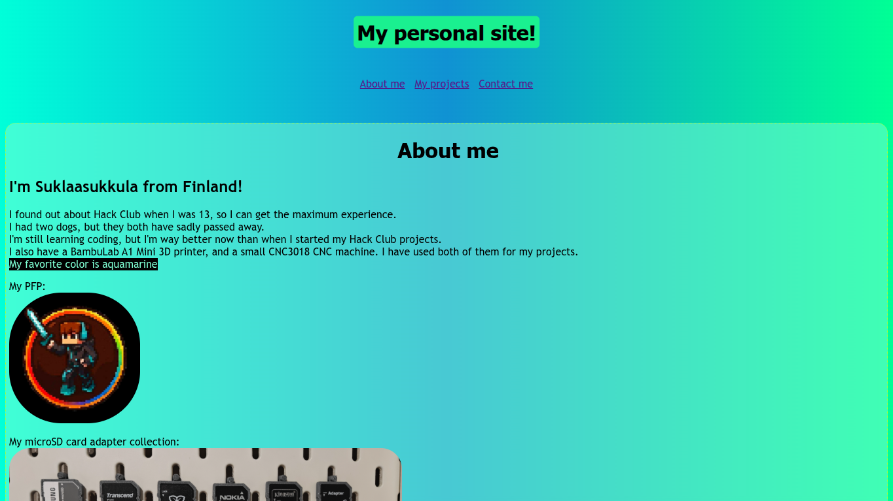
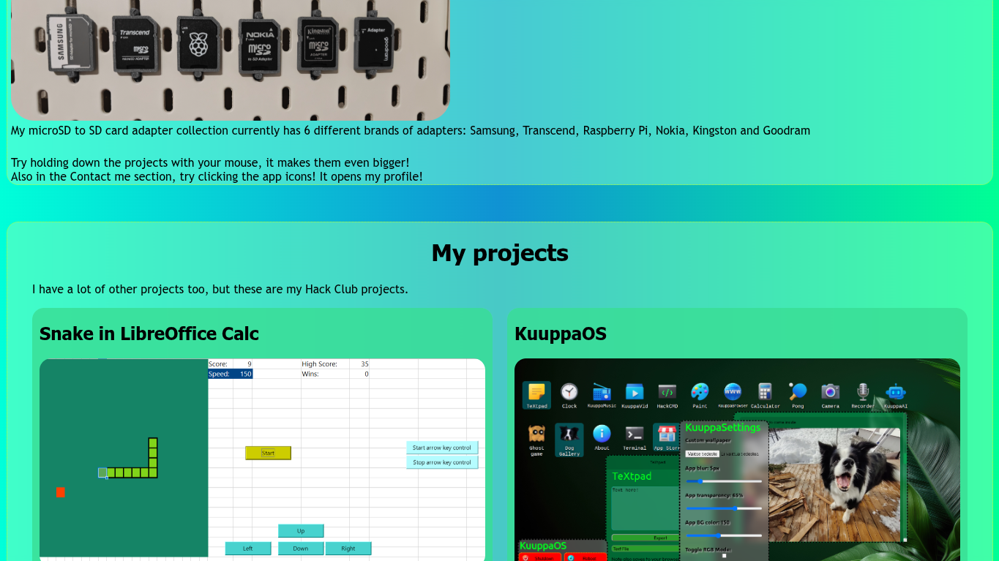
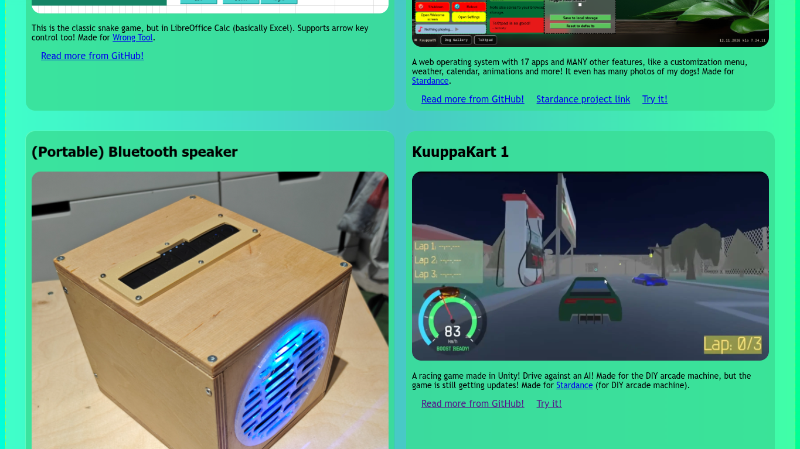
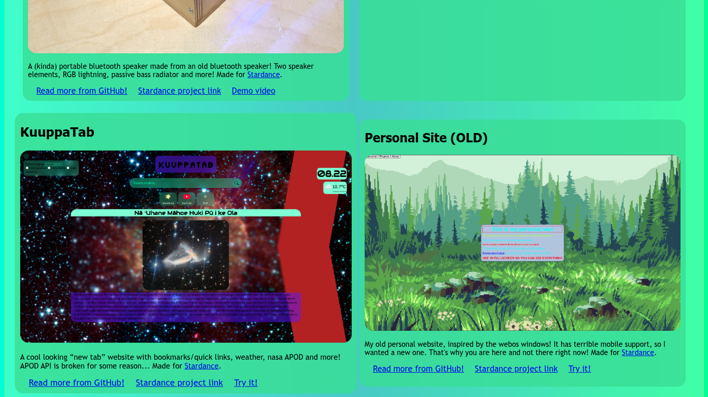
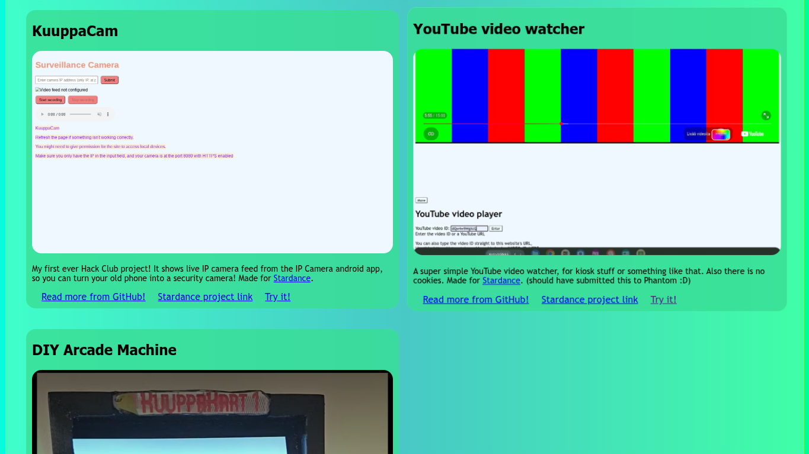
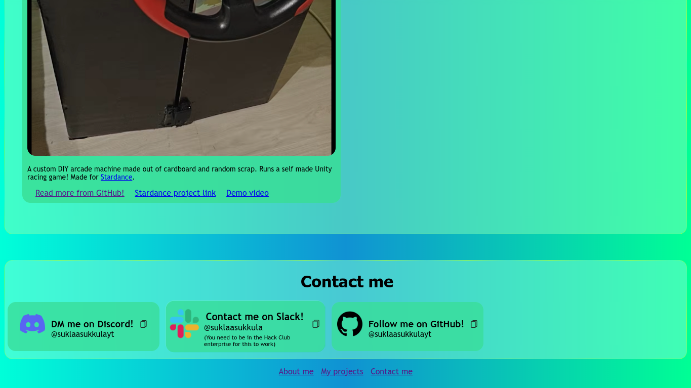

# Personal Site  

## Random info:  
My new and improved personal website!  
Made for the [Phantom Hack Club](https://phantom.hackclub.com) event  

## This has:  
#### Three sections:  
1. About me:  
    - just some info about me (and some for this site)  
2. My projects  
    - list of my Hack Club projects with photos and links  
3. Contact me  
    - links to some of my social media profiles  

#### Animations:  
- Hover animations  
- Click animations  
- Hold animations  
- Smooth scroll to different sections  

#### Good CSS (atleast I think so)  

#### Popup when clicking the copy button (Contact me section)  

#### and more!  

## Screenshots:  
  
  
  
  
  
  

## AI USAGE:  
- Debugging when something isn't working  
Yeah that's it, **no** "claude chatgpiti make this website 10000 times better make no mistakes", even this README is 100% human written  